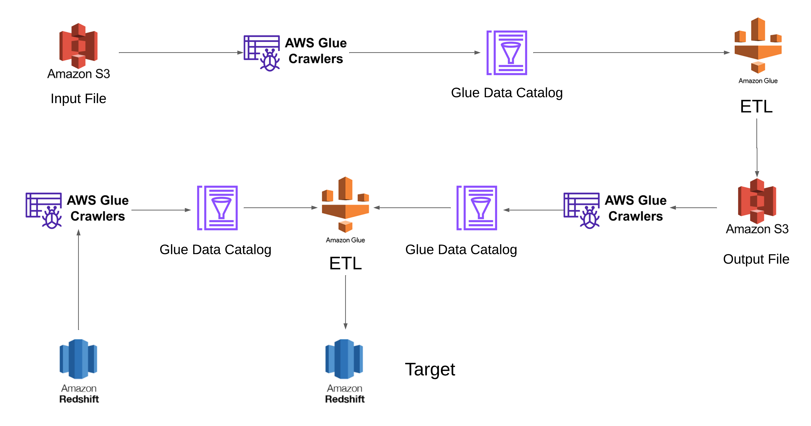
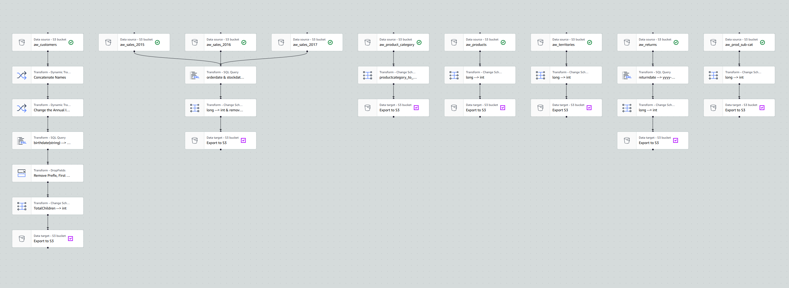
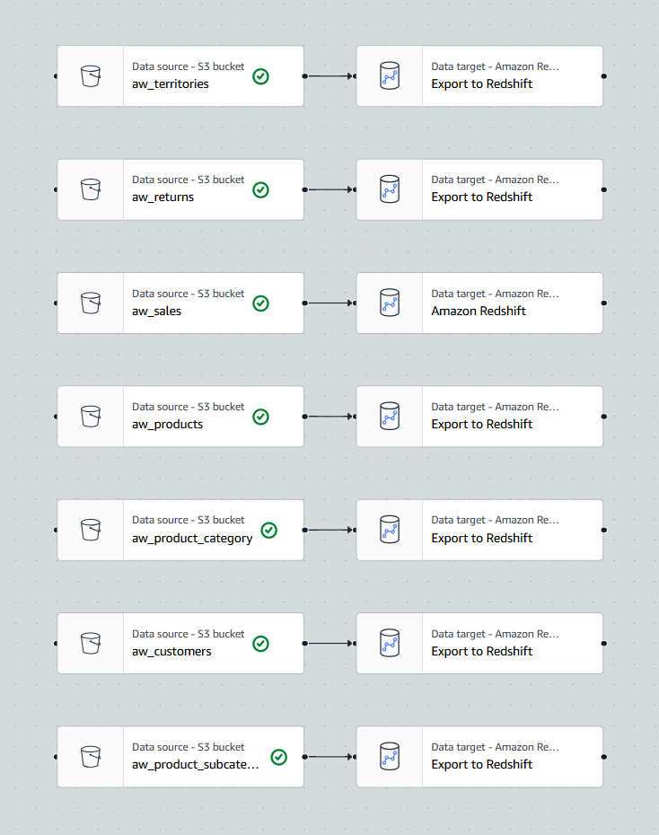

# AWS Data Engineering ETL Pipeline

An end-to-end data engineering project demonstrating data ingestion, transformation, data quality validation and cloud data warehousing using AWS services.

## Project Overview

This project uses the Adventure Works Sales Dataset from Kaggle to demonstrate an ETL pipeline. Raw CSV files are ingested into Amazon S3, transformed using AWS Glue and PySpark, and loaded into Amazon Redshift for analytical querying.

**Dataset:** [Adventure Works Sales Dataset](https://www.kaggle.com/datasets/ukveteran/adventure-works)

## Technology Stack

- **Amazon S3:** Storage for raw and processed datasets.
- **AWS Glue:** ETL processing and metadata extraction.
- **PySpark:** Data transformation and cleaning.
- **Glue Data Catalog:** Centralized metadata management.
- **Amazon Redshift:** Cloud data warehouse.
- **Boto3:** AWS service integration using Python.
- **Kaggle API:** Dataset download and ingestion.
- **SQL:** Data transformation and analytical querying.

## Project Architecture



## Project Workflow

### 1. Data Ingestion
- Download Adventure Works CSV files using the Kaggle API.
- Upload raw datasets to Amazon S3 using Boto3.

Notebook: `Scripts/Kaggle_to_S3_using_boto3.ipynb`

### 2. Metadata Extraction
- Configure an AWS Glue crawler to scan raw files in S3.
- Register dataset schemas in the Glue Data Catalog.

### 3. Data Transformation
- Read source datasets through the Glue Data Catalog.
- Perform date standardization, type conversions and customer-name transformations using PySpark and Spark SQL.
- Apply data quality checks.
- Store transformed datasets in S3 in Parquet format.

Notebook: `Scripts/AW_ETL_Job.ipynb`



### 4. Processed Data Cataloging
- Use a second Glue crawler to catalog transformed datasets.
- Register the processed schemas for downstream access.

### 5. Redshift Table Creation
- Create target tables in Amazon Redshift.
- Align target table structures with the processed dataset schemas.

Notebook: `Scripts/Redshift_Table_Creation_ETL_Job.ipynb`

### 6. Loading Data into Redshift
- Read processed datasets from S3 through the Glue Data Catalog.
- Load the data into corresponding Amazon Redshift tables.

Notebook: `Scripts/Load_From_S3_to_Redshift_ETL_Job.ipynb`



## Repository Structure

```text
AWS-End-to-End-ETL-Pipeline/
│
├── Diagrams/
│   ├── Data_Architecture.png
│   ├── ETL_Diagram.png
│   └── Load_From_S3_to_Redshift_ETL_Job.png
│
├── Scripts/
│   ├── Kaggle_to_S3_using_boto3.ipynb
│   ├── AW_ETL_Job.ipynb
│   ├── Redshift_Table_Creation_ETL_Job.ipynb
│   └── Load_From_S3_to_Redshift_ETL_Job.ipynb
│
└── README.md
```

## Configuration

Before running the notebooks:

- Configure Kaggle API authentication.
- Configure AWS credentials using an AWS profile, environment variables or IAM roles.
- Set the required S3 bucket names and folder paths.
- Configure the AWS Glue Data Catalog and required crawlers.
- Set up the Redshift cluster and Glue connection.
- Ensure the required IAM permissions are available.

Never commit AWS credentials, secret keys or Kaggle API tokens to the repository.

## Validation and Testing

The ingestion notebook can be tested locally with the required Python dependencies and AWS credentials.

The AWS Glue notebooks require an appropriately configured AWS Glue environment, Glue Data Catalog resources and Redshift connectivity.

Verify S3 output files, Glue job logs, data quality results and Redshift table contents when executing the complete pipeline.

**Note:** This repository does not provision AWS resources automatically. Actual cloud deployment and execution require separate AWS configuration.

## Credits and Attribution

This repository is a modified version of the original public project:

[Original AWS End-to-End ETL Pipeline](https://github.com/prthm2910/AWS-End-to-End-ETL-Pipeline)

Original author: `prthm2910`

Maintainer of this modified version: **[Your Name]**

Modifications and contributions should be documented as they are made.

